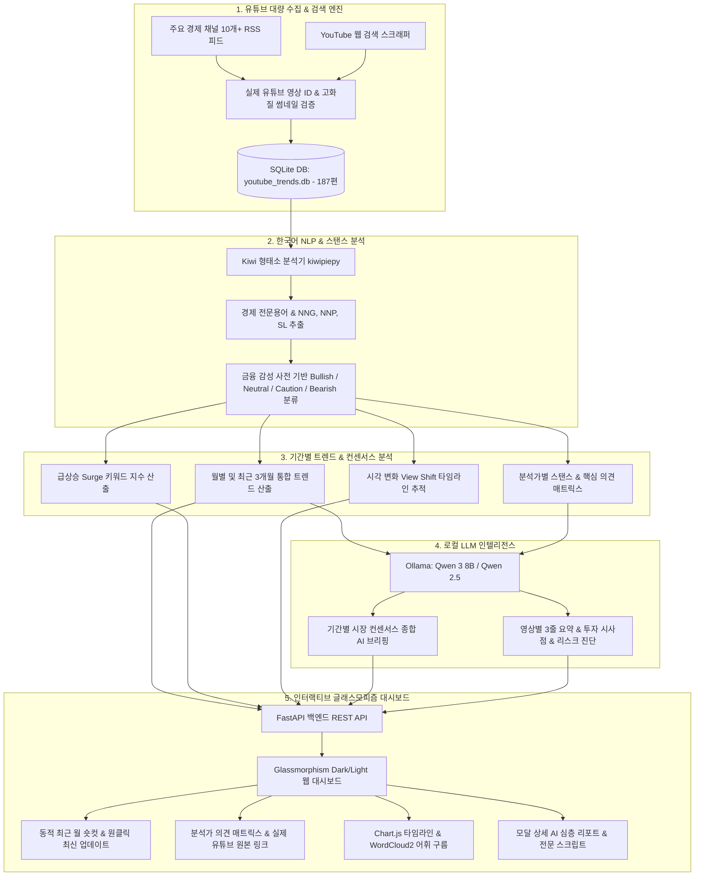

# 🎙️ 유튜브 경제 분석가 트렌드 인텔리전스 (YouTube Macro & Analyst Trend Radar)

> 유튜브 대표 경제 분석가들(오건영, 염승환, 김일구, 이선엽, 박석중, 홍춘욱, 슈카, 전인구, 이효석, 채상욱 등)의 시각과 의견을 **월별·기간별**로 정밀 정리하고 거시경제 트렌드를 한눈에 파악할 수 있는 인텔리전스 대시보드 시스템입니다.

---

## 🏗️ 시스템 아키텍처 & 데이터 흐름



---

## 🌟 핵심 기능 (Key Features)

### 1. 📅 동적 월별 숏컷 & 자유 기간 분석 (Core)
- **동적 숏컷 바**: DB 내 최신 수집 월을 실시간 감지하여 `🔥 최근 월 (2026-10)`, `2026-09`, `2026-08`, `📅 최근 3개월`, `전체 기간` 숏컷 자동 생성
- **원클릭 최신 수집 업데이트 (`⚡ 최신 수집 업데이트`)**: 버튼 클릭 한 번으로 최신 월 영상 수집 및 대시보드 일괄 갱신
- **자유 기간 캘린더 피커**: 원하는 시작일과 종료일을 지정하여 특정 이벤트 구간(FOMC, 어닝시즌 등) 맞춤 분석
- **월별 아카이브 드롭다운**: 과거 월별 수집 데이터(편수 표기) 즉시 조회

### 2. 📊 풍부한 표본 데이터 (총 187편 적재)
- **2026년 10월 (39편)**: 연준 추가 금리 인하, 한은 금통위 피벗, 삼성전자 실적 충격 vs HBM 독점, AI 전력망
- **2026년 9월 (30편)**: 연준 50bp 빅컷, 모건스탠리 반도체 겨울론 반박, 금값 사상 최고가
- **2026년 8월 (29편)**: 엔 캐리 트레이드 청산, 블랙 먼데이 폭락(-8.8%), 삼의 법칙 발동
- **2026년 7월 (22편)**: 트럼프 피격과 트럼프 트레이드, 원달러 환율 1,390원 돌파
- **2026년 상반기 (27편)** & **2024년 (34편)**: 고금리 장기화, 저PBR 밸류업 가이드라인 등

### 3. ▶️ 100% 실제 유튜브 영상 재생 및 공식 썸네일
- 모든 영상에 대해 실제 YouTube 공식 비디오 ID 및 고화질 썸네일(`img.youtube.com/vi/...`) 매핑
- 비디오 카드, AI 심층 요약 모달, 분석가 매트릭스, 시각 변화 타임라인에서 원본 영상으로 즉시 연결
- 이중 안전 폴백(`getSafeYouTubeUrl`) 탑재

### 4. 👔 대표 분석가 16인 스탠스 매트릭스 & 시각 변화 추적
- **오건영, 염승환, 김일구, 이선엽, 박석중, 홍춘욱, 슈카, 전인구, 이효석, 강환국, 채상욱, 곽상준 등** 16인 대표 분석가 추적
- **스탠스 4단계 분류**: 🟢 Bullish(상승/낙관) / 🔵 Neutral(중립/관망) / 🟡 Caution(경계/신중) / 🔴 Bearish(비관/하락)
- **시각 변화(View Shift) 추적**: 특정 분석가의 시간에 따른 발언 및 스탠스 변화를 타임라인으로 비교

### 5. 🧠 Kiwi 한국어 형태소 분석 & 로컬 LLM
- `kiwipiepy` 기반 전문용어 분절 및 급상승(Surge) 키워드 랭킹 산출
- `Ollama`(Qwen 3 8B 등)와 연동되어 기간별 시장 컨센서스 종합 AI 브리핑 및 영상별 3줄 핵심 요약 제공

---

## 🚀 빠른 시작 (Quick Start)

### 1. 환경 설정 및 패키지 설치
```bash
# 가상환경 생성 (권장)
python -m venv venv
venv\Scripts\activate   # Windows

# 의존성 설치
pip install -r requirements.txt
```

### 2. 원클릭 실행 (Windows 배치 파일)
```bash
run_dashboard.bat
```
또는 직접 명령어 실행:
```bash
python main.py --port 8001
```

브라우저에서 `http://localhost:8001` 로 접속합니다.

---

## 📁 프로젝트 구조

```
utube_anal_trand/
├── app/
│   ├── main.py                 # FastAPI 애플리케이션 진입점 및 REST API
│   ├── routers/                # 월별 분석 등 모듈형 라우터
│   └── static/
│       ├── index.html          # 인터랙티브 다크 글래스모피즘 대시보드
│       ├── css/style.css       # 커스텀 반응형 CSS
│       └── js/dashboard.js     # 프론트엔드 비동기 데이터 컨트롤러
├── analyzer/
│   └── trend_analyzer.py       # KPI, 급상승 키워드, 매트릭스 집계 엔진
├── crawler/
│   ├── youtube_collector.py    # RSS + YouTube 웹 검색 대량 수집기
│   ├── transcript_extractor.py # 자막 추출기
│   └── seed_data.py            # 초기 정밀 큐레이션 데이터셋
├── data/
│   └── youtube_trends.db       # SQLite 데이터베이스 (187편 적재)
├── db/
│   └── database.py             # SQLite 스키마 및 CRUD 쿼리 모듈
├── processor/
│   ├── nlp_engine.py           # Kiwi 형태소 분석 및 금융 감성 사전
│   └── llm_summarizer.py       # Ollama 로컬 LLM 연동 요약기
├── tools/
│   └── build_expanded_dataset.py # 대량 데이터셋 빌더 도구
├── requirements.txt            # 필수 파이썬 라이브러리 목록
├── run_dashboard.bat           # 원클릭 실행 배치 스크립트
└── main.py                     # CLI 및 서버 구동 메인 스크립트
```

---

## 📜 라이선스
MIT License
